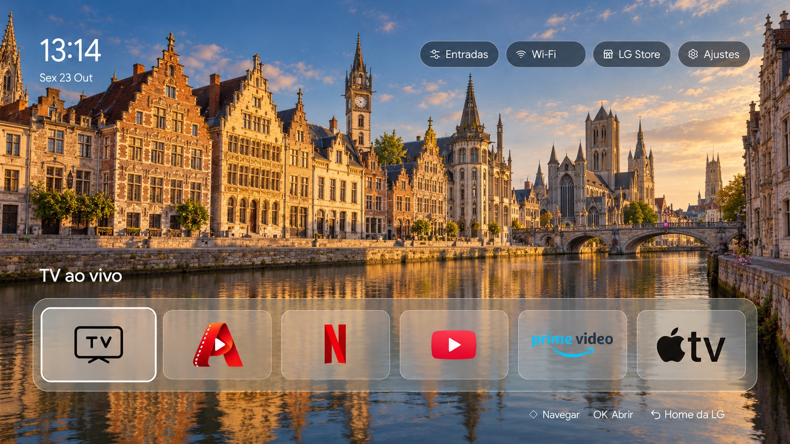
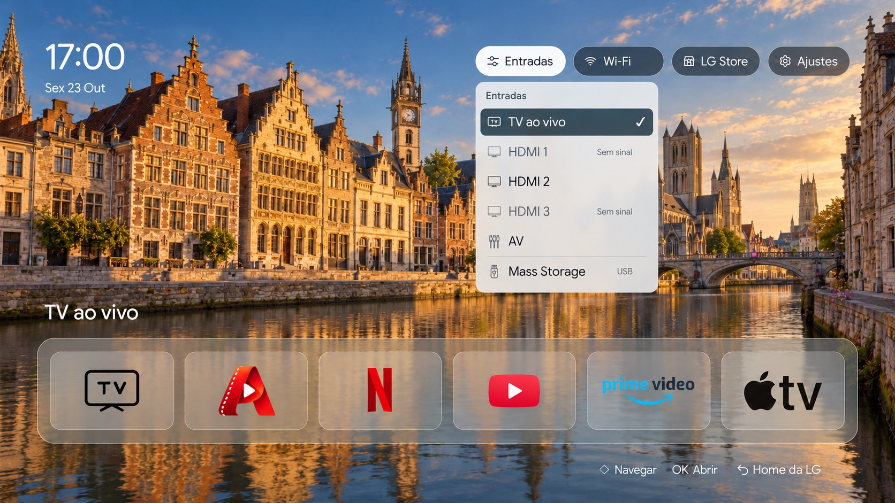

<div align="center">

# PersonalHome

### A Native Custom Home for LG webOS 4.4

A custom Home experience inside LG's native compositor, with app shortcuts, personal wallpapers, system controls, and guarded recovery.

[](#compatibility) [](#compatibility) [](#compatibility) [](#how-it-works) [](#project-status)

[Overview](#overview) · [Screenshots](#screenshots) · [Features](#features) · [Architecture](#how-it-works) · [Getting Started](#getting-started) · [Safety](#safety-and-recovery) · [Documentation](#documentation)



<sub>Interface from a recorded LG capture. AI-generated Ghent wallpaper and generic network label. <a href="docs/assets/README.md">Image provenance</a>.</sub>

</div>

> [!IMPORTANT]
> Experimental, with provisional use recorded on one television. Startup delays and incomplete recovery acceptance remain open. This is a source repository for development, with no general-purpose installer.

## Overview

PersonalHome replaces the original LG Home experience with a photo-led interface built in Qt/QML. It keeps native application launching, input selection, and access to LG controls in the existing `surface-manager-starfish` compositor.

Created for one owner's TV, it puts everyday shortcuts and controls on a single screen. Its recovery safeguards and optional privacy controls have explicit limits, documented below.

## Screenshots

The hero shows the main Home with Live TV focused. The second view shows the native input dropdown, including signal status and attached USB storage.

<p align="center">
  
</p>

Both source views were captured on the LG on October 23, 2026, with the updated transparent logos. The illustrative Ghent wallpaper and generic network label replace private content. These are edited presentation assets, not new physical-test evidence. See [image provenance](docs/assets/README.md).

## Features

- Six shortcuts for Live TV, Abrantesflix, Netflix, YouTube, Prime Video, and Apple TV.
- Remote and pointer navigation, visible focus, and native Back/Home handling.
- Owner-supplied rotating wallpapers, with photo cycling paused while Home is hidden.
- An input dropdown for Live TV, HDMI, AV, and attached USB storage.
- Clock, connected-network label, LG Content Store, settings, and an original LG Home action.
- Guarded startup and two local recovery actors that check release integrity, process identity, and interface health.
- Backup and readback-based controls for optional advertising, tracking, and diagnostic preferences.

Application shortcuts do not certify login or playback for every service. Reliability work and privacy persistence remain in progress.

## Compatibility

| Component | Recorded target |
| --- | --- |
| LG model | 49UK6310PSE |
| Firmware | 05.50.70 |
| webOS | 4.4.0 |
| CPU | ARMv7 |
| Qt | 5.6.2 |
| Native compositor | `surface-manager-starfish` |

Other LG models, firmware revisions, and webOS versions have not been verified. The product interface is in Brazilian Portuguese.

## How It Works

The QML scene runs inside the existing native compositor. A firmware-specific adapter connects it to LG launchpoints and native services for apps, inputs, and system controls.

The bootstrap validates the original executable and release hashes, waits for native readiness, and activates the custom scene. The recorded startup path requires a compositor restart after the original environment has started, which can delay Home and reveal the original LG interface first.

Two recovery actors monitor ownership, identity, peer pulses, and visible-interface health. On failure, they attempt to remove their own overlay and restore the original compositor and a usable foreground. Restoring the executable alone does not prove that the TV is usable.

See [architecture](docs/architecture.md) for module boundaries and external firmware inputs.

## Getting Started

Start with offline development. You need Git, Python 3, and Node.js for the checks below:

```sh
git clone https://github.com/matheusabrantes/lg-webos-4.4-personal-home.git
cd lg-webos-4.4-personal-home

node src/personalhome/operations/test_policy.js
node src/personalhome/operations/test_guard.js
python3 -m unittest discover -s src/personalhome/operations -p test_device_session.py -v
python3 src/personalhome/tests/test_recovery.py
```

These checks use fixtures and do not contact the TV. A QML preview additionally needs PyQt5 and locally supplied wallpapers. Native builds require matching, privately held firmware artifacts and verified release inputs; a fresh clone is not a deployable firmware package.

Follow [local development](docs/development.md) for preview setup, build preparation, and private device configuration. Read [device safety](docs/device-safety.md) before preparing any physical session.

## Safety and Recovery

The original LG Home action, retained original executable, guarded overlay removal, and local watchdogs provide recovery paths. Installation and rollback validate release hashes, ownership, process identity, and mount state before acting.

Two controlled recovery cases succeeded on the recorded TV. Complete recovery acceptance remains open: a later rollback restored the executable but reported an unusable interface. Cold startup and long standby also need further validation.

Use the [device safety guidance](docs/device-safety.md) and [recorded limitations](docs/status.md). Historical authorizations do not authorize a new device session.

## Privacy

The privacy tools aim to reduce unwanted promotions and optional tracking while retaining essential television functions. They back up settings, validate native agreement mappings, and verify readback when applying supported controls.

Optional preferences and agreements were recorded as disabled, but `uploader.analyticsLog` was enabled in a later readback. Persistence and complete telemetry removal have not been established. See [privacy controls and limits](docs/privacy.md).

Personal photos, SSH keys, connection settings, backups, and raw captures stay outside Git. Only reviewed icons and the two privacy-edited README images are allowed by the image exceptions.

## Project Status

Last recorded physical acceptance: **October 23, 2026**. These are historical results, not a claim about the TV's current state.

| Area | Recorded state |
| --- | --- |
| Native integration | Rendered on the target compositor |
| Visual interface | Six cards, transparent logos, wallpapers, and controls verified |
| Application navigation | Remote/pointer verified; playback evidence covers only selected services |
| Startup and standby | Delayed startup observed; long standby and overnight behavior unverified |
| Recovery | Controlled cases passed; complete acceptance unresolved |
| Privacy hardening | Optional controls implemented; persistence and uploader behavior unresolved |
| Permanent deployment | Provisional owner use; not ready for general deployment |

Read the [recorded status](docs/status.md) for the scope of physical testing and remaining limitations.

## Documentation

- [Architecture](docs/architecture.md): QML, native integration, startup, and recovery.
- [Local development](docs/development.md): offline checks, preview, build inputs, and private transport.
- [Device safety](docs/device-safety.md): physical-session requirements and recovery constraints.
- [Privacy](docs/privacy.md): implemented controls, observed behavior, and publication hygiene.
- [Recorded status](docs/status.md): physical acceptance, playback scope, and known limitations.
- [Image provenance](docs/assets/README.md): source captures and public-image edits.
- [Contributing](CONTRIBUTING.md): change scope, verification, and private-data handling.

## Credits and License

Built with Qt/QML for LG webOS. Application names and logos identify their respective services. The bundled Google Sans fonts retain their license and trademark notices.

No project-wide license is currently declared. See [third-party notices](NOTICE.md). LG firmware binaries, extracted proprietary resources, and personal wallpapers are not distributed.
